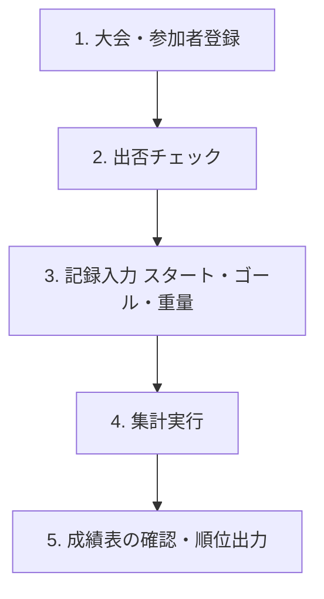

# 歩荷大会マネージャー 操作マニュアル

本ドキュメントは、登山・歩荷（ボッカ）大会の記録管理および成績集計システム**「歩荷大会マネージャー」**の操作マニュアルです。

---

## 目次
1. [システム概要](#1-システム概要)
2. [基本操作の流れ](#2-基本操作の流れ)
3. [各画面の使い方](#3-各画面の使い方)
   - [3.1 大会・参加者情報画面](#31-大会参加者情報画面)
   - [3.2 記録画面](#32-記録画面)
   - [3.3 成績画面](#33-成績画面)
   - [3.4 ハンデ画面](#34-ハンデ画面)
4. [隠し機能・管理者モード](#4-隠し機能管理者モード)
5. [トラブルシューティング・データリセット](#5-トラブルシューティングデータリセット)

---

## 1. システム概要

「歩荷大会マネージャー」は、歩荷競技におけるタイム、荷物重量、参加者属性（年齢・性別）に基づいたハンデ計算および成績集計をリアルタイムで行うWebアプリケーションです。

- **自動保存**: 入力したデータはブラウザ内（IndexedDB）に即時保存されます。
- **オフライン対応**: PWA対応により、山中などインターネット接続のない環境でも動作します。

---

## 2. 基本操作の流れ

大会当日の基本的な運用手順は以下の通りです。

1. **事前準備**: 「大会・参加者情報」画面で大会名、開催日、参加者一覧を登録します。
2. **当日の受付**: 当日参加する人にチェックを入れます。
3. **競技中**: 「記録」画面で荷物重量、開始時刻、終了時刻を入力します。
4. **集計**: 「集計」ボタンを押し、成績計算を行います。
5. **結果発表**: 「成績」画面で順位やタイムを確認・公表します。

---

## 3. 各画面の使い方

ナビゲーションバー（画面上部）のタブをタップ／クリックして画面を切り替えます。

### 3.1 大会・参加者情報画面

大会の基本情報と参加者リストを管理する画面です。

#### 【基本情報の入力】
- **大会名**: 「第〇回 歩荷大会」などの名称を入力します。
- **開催日**: `YYYY-MM-DD` 形式で入力します（例: `2026-09-24`）。

#### 【参加者リストの操作】
| 項目 | 説明 |
| :--- | :--- |
| **参加** | 当日参加する場合はチェックを入れます。未チェックの人は記録の選択肢から自動除外されます。 |
| **氏名** | 参加者の名前を入力します。 |
| **性別** | 「男」または「女」を選択します。 |
| **生年月日** | `YYYY-MM-DD` 形式で入力します。 ※ スマート入力に対応（例: `000512` → `2000-05-12` / `850315` → `1985-03-15`）。 |
| **年齢** | 生年月日と開催日から自動計算されます。 |
| **区分** | 「学生」または「OB」を選択します。 |
| **入部年** | 入部した西暦を入力します（学生の学年計算に使用されます）。 |
| **操作** | 「削除」ボタンで参加者をリストから削除します。 |

- **`+ 追加` ボタン**: 新しい参加者行を追加します。

---

### 3.2 記録画面

タイムおよび背負う重量を記録する画面です。

#### 【記録の入力手順】
1. **`＋ 追加` ボタン**を押して新しい記録行を作成します。
2. **参加者**: ドロップダウンから対象の参加者を選択します。
3. **重量(kg)**: 背負う荷物の重量（kg）を入力します。
4. **開始時刻 / 終了時刻**:
   - **「今」ボタン**: ボタンを押した瞬間の時刻（`HH:mm:ss`）が自動入力されます。
   - **手動入力**: 枠内に直接時刻（例: `09:30:00`）を入力・修正することも可能です（手動修正タグが表示されます）。
5. **集計手順**:
   - 記録入力完了後、画面下の **`集計` ボタン** を押します。
   - 確認ダイアログで「はい」を選択すると、計算が行われ自動的に「成績」画面へ移動します。
6. **全削除**:
   - **`すべてを削除` ボタン** で全記録をクリアできます（成績画面は一時的にロックされます）。

---

### 3.3 成績画面

集計された成績・順位を確認する画面です。

#### 【表示・フィルタ機能】
- **ソート基準**:
  - **ハンデあり**: ハンデ適用後のタイム（昇順）で順位付けします。
  - **ハンデなし**: 実際の所要タイム（昇順）で順位付けします。
- **表示対象**:
  - **学生** / **OB** のチェックボックスで表示対象を絞り込むことができます。

#### 【成績表の項目】
- **順位** / **氏名** / **区分（学年）** / **性別** / **年齢** / **重量**
- **ハンデありタイム** / **ハンデなしタイム**

---

### 3.4 ハンデ画面

適用されているハンデ設定および計算式を確認する画面です。

- **性別ハンデ**: 性別ごとの補正値一覧。
- **年齢ハンデ**: 年齢に応じた補正値一覧。
- **重量ハンデ**: 重量に応じた補正値一覧。
- **ズーム機能**: 画面右上の `+` / `-` ボタンでテーブルの文字サイズを調整できます。
- **成績計算について**: システムで使用されている計算ロジック（JavaScriptコード）が表示されます。

---

## 4. 隠し機能・管理者モード

特定のアクションを行うことで、管理者向けの隠しメニューが表示されます。

### 4.1 名簿データのJSON出力
- **操作**: ナビゲーションバーの **「大会・参加者情報」** を **5回連続クリック** します。
- **機能**: 参加者リスト下に **`名簿出力` ボタン** が出現し、登録データを `participants.json` ファイルとしてダウンロードできます。

### 4.2 高度なハンデ設定（秘密の設定）
- **操作**: ナビゲーションバーの **「ハンデ」** を **5回連続クリック** します（またはURL末尾に `#secret` を付与）。
- **機能**: 画面下部に **「高度なハンデ設定 (秘密)」** カードが表示されます。
  - **男性/女性ハンデ（秒）** の変更
  - **年齢スロット / 重量スロット** の閾値および加減算秒数の変更
  - **ハンデ設定を保存** ボタンで反映できます。

---

## 5. トラブルシューティング・データリセット

### Q. データがおかしくなった / 初期状態に戻したい
「ハンデ」画面の秘密設定（上記4.2参照）を開き、一番下にある **`全データを消去してリセットする`** ボタンを押すことで、すべてのデータ（参加者・記録・設定）をクリアできます。

### Q. オフラインで動作しない
一度オンライン状態でページを開いた後であれば、次回以降はネットワークが繋がらない環境でもそのまま利用できます。
